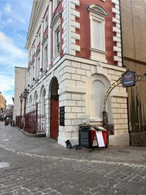
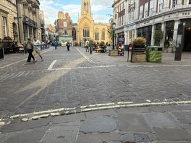

# Macroeconomic and Financial Modelling in an Era of Extremes

> **Thank you for attending!** The workshop took place on Monday 12 October 2026. We hope to see you again.

**Date:** Monday 12 October 2026 
**Venue:** The Riverside Room, The Guildhall, York 
**Website:** https://efx-york26.github.io/York_Workshop_2026/

## About

This workshop brings together leading experts on macroeconomic and financial modelling to discuss recent advances in the modelling of extreme events. The workshop will be of interest to academic researchers at all levels, policymakers and practitioners.

## Programme

| Time | Session |
|------|---------|
| 09:30 – 10:00 | Morning coffee, followed by opening remarks by Michael Thornton |
| 10:00 – 10:30 | *Contagion and Immunisation: Directional Comoment Tests* Renee Fry-McKibbin *Australian National University* |
| 10:30 – 11:00 | *Search Effort, Screening Capacity, and the Matching Function: Evidence from Online Vacancies* Tho Pham *University of York* |
| 11:00 – 11:30 | *Equilibrium Treatment Effects with Network Interference and Latent Factors* Yongcheol Shin *University of York* |
| 11:30 – 11:50 | *Coffee break* |
| 11:50 – 12:20 | *Common and Hazard-Specific Variation in U.S. Natural Disaster Losses* Matthew Greenwood-Nimmo *University of Melbourne* |
| 12:20 – 12:50 | *Semiparametric forecast comparison in unstable environments* Laura Coroneo *University of York* |
| 12:50 – 14:00 | *Lunch* |
| 14:00 – 14:30 | *Quantile Inflation Spillover Networks of the G7: Transmission and Propagation* Ze-Yu Zhong *Melbourne Business School* |
| 14:30 – 15:00 | *Bootstrap Inference in Factor-Augmented Regressions with Weak Factors* Takashi Yamagata *University of York* |
| 15:00 – 15:30 | *Advancing Multi-Dimensional Spatial/Network Econometrics: The MSAR Framework* Chaowen Zheng *University of Southampton* |
| 15:30 – 15:50 | *Coffee break* |
| 15:50 – 16:20 | *Nonparametric Dyadic Quantile Regression* Francesco Bravo *University of York* |
| 16:20 – 16:50 | *The Quantile Vector Autoregressive Model with Observed Common Factors* Daniel Tiong *University of Melbourne* |
| 16:50 – 17:20 | *TBA* Byunghoon Kang *Lancaster University* |

## Dinner

18:00 – 20:00
Chopping Block at Walmgate Ale House
25 Walmgate, York YO1 9TX
([map](https://www.google.com/maps/search/?api=1&query=Chopping+Block+at+Walmgate+Ale+House,+25+Walmgate,+York+YO1+9TX))

## Venue

The Riverside Room, The Guildhall
St Martin's Courtyard, Coney Street
York YO1 9QL, United Kingdom
([map](https://www.google.com/maps/search/?api=1&query=The+Guildhall,+Coney+Street,+York+YO1+9QL))

**The Entrance to the Guildhall:**

From the Mansion House building, walk through the archway to the bottom.

*Guildhall*

*The view from the side of the building, Miller & Carter, and Tomahawk will be on your right.*

*The view looking out from the Guildhall entrance to St Helen's Square.*

## Practical Information

- Wi-Fi: please use the *UoY-Fi* network

## Local Organiser

Yongcheol Shin (*University of York*)

## Organising Committee

- Tomohiro Ando (*Melbourne Business School*)
- Renee Fry-McKibbin (*Australian National University*)
- Matthew Greenwood-Nimmo (*University of Melbourne*)
- Yongcheol Shin (*University of York*)

## Contact

Yongcheol Shin (Workshop)
[yongcheol.shin@york.ac.uk](mailto:yongcheol.shin@york.ac.uk)

---

This workshop is jointly funded by the Australian Research Council (grant number DP240101009) and the University of York.
